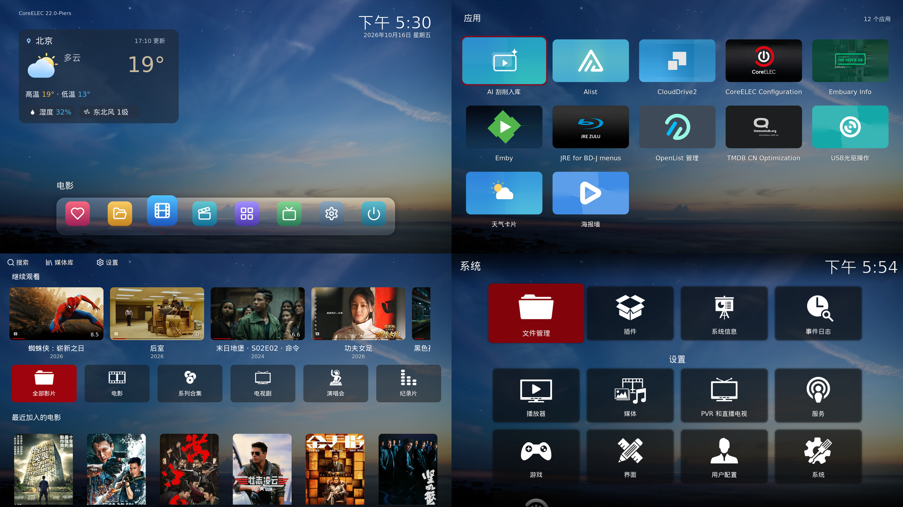
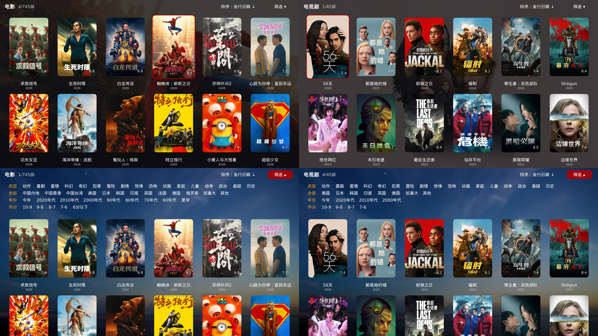

# S905X2 CoreELEC 22 NO系统 修复版

基于 [CoreELEC](https://github.com/CoreELEC/CoreELEC) 官方 `coreelec-22` 分支，为电焊哥 **S905X2（RTL8822CS Wi-Fi）** CEBOX盒子制作的专用修复源码。

该盒子使用官方 Amlogic-no 出现启动交接花屏和 HDMI 4K60花屏、Wi-Fi 吞吐不足，以及部分 Dolby Vision Profile 7 FEL 影片 seek／续播色块、绿线等故障。

需区分 dtb 板级修复和 coreelec 内核修复，基于 dtb 板极的修复只对使用通用 S905X2 dtb 文件的盒子有效，镜像默认内置修复版的s905x2通用版的dtb文件，如果使用其他dtb或其他s905x2专用dtb则板极修复不生效，但是内核级的修复仍然有效。修复是否生效，请具体看修复内容，应用的位置，有些故障是dtb和内核共同作用的，另外电焊哥的盒子硬件版本也较多，不保所有设备上修复有效。

**不保证兼容所有 S905X2 盒子。** 同一 SoC 的不同板型可能使用不同内存、无线芯片和 framebuffer 地址。本项目不是 CoreELEC 官方发行版。

[下载最新正式版本](https://github.com/Jioyzen/CoreELEC/releases/latest) · [全部版本](https://github.com/Jioyzen/CoreELEC/releases) · [构建记录](https://github.com/Jioyzen/CoreELEC/actions/workflows/s905x2-weekly.yml) · [详细技术说明](S905X2.md)

## CoreELEC 的 Amlogic-NO（New Order）更新的内容
有不少朋友问NO版本有哪些更新，与NG有啥区别，官方并没有统一的做总结，但是大致有以下区别：

CoreELEC 的 Amlogic-NO（New Order）相比 Amlogic-NG，属于一次底层平台的大规模升级，而不只是 Linux 内核从 4.9 升级到 5.15
1. 底层架构重构：64 位用户空间、Linux 5.15、更新的驱动和系统组件。
2. 视频播放改进：音画同步、字幕卡顿、杜比视界处理等。
3. 杜比视界 FEL 支持：NO 已经实现双层杜比视界，不再是 NG 独有的能力。
4. 设备支持扩大：支持更新的 Amlogic SoC，同时淘汰部分老芯片。
5. Kodi 22 与 FFmpeg 升级：媒体播放框架与解码组件更新。
6. 插件兼容性变化：原先 NG 上的 32 位二进制插件不能直接沿用。
7. 
但是实际效果需要自测，不代表所有设备都能工作正常，我这台S905X2就是个例子，遇到的问题并不少。

## 修复内容

| 问题 | 修复方式 |
|---|---|
| HDMI 2160p50/60 花屏 | 修正专用 DTB 的 VPU 时钟档位，恢复 666.7MHz；没有通过降低分辨率规避 |
| 启动显示交接花屏 | framebuffer 预留地址与实际 U-Boot 配置对齐：`0x7f800000`、8MiB |
| SDIO 接口速率受限 | 专用 DTB 开启 SDR104 高速模式，使用对应控制器频率配置 |
| RTL8822CS Wi-Fi 吞吐慢 | 源码构建适配 NO 内核的厂商驱动，启用 NAPI/GRO，调整省电参数；实测约 **97.05 → 578.76 Mbps**，不同网络环境速度会变化 |
| 部分 DV P7 FEL 影片 seek 花屏、色块、绿线 | 修复增强层参考帧预解码与错误标记，在显示前成对跳过无效 BL/EL，保留有效旧帧配对 |
| 从保存进度续播出现色块 | Kodi 缓存、补送增强层 VPS/SPS/PPS，冷起播有界暂存并按原顺序回放数据与 PTS |
| 红外码表重新加载后遥控失效或内核崩溃 | 修复 meson IR 输入设备数组越界、重复计数与能力注册顺序 |
| 电视/功放关闭时启动后 HDMI 有信号但黑屏 | 补齐专用 DTB 的视频路由控制器节点，使内核能切换到 HDMI 使用的编码器，恢复场同步 |
| 移动红外遥控无法从关机状态唤醒 | 实验性的使用 mailbox 通道向 BL30 下发电源码实现关机唤醒，无需修改Bootloader，可在有BL锁设备上实现真正的关机唤醒 |
| 电源指示灯运行时红色、关机后蓝色 | 修正专用 DTB 的 GPIOAO_11 LED 极性，运行时蓝色、关机后红色 |

- 修复杜比视界seek花屏的同时，完整 DV/FEL 解码与合成保持启用，HDR 使用原有路径
- S905X2专用 DTB 已作为镜像默认 `dtb.img`，内置已验证的 `dovi.ko`
- 内核、媒体模块、Wi-Fi 驱动和 Kodi 从对应源码构建
- 码镜像已由目标盒子实机确认：正常启动，HDMI、Wi-Fi、DV seek／绿线修复有效

## 提供官方源码构建的镜像和包含皮肤等常用插件的开箱即用版本的镜像
两个版本的镜像每周日自动合并上游代码，由Actions自动构建并发布，升级通道是独立的，互不干扰，可每周自动更新系统（没有特殊的修复情况下就是同步上游最新代码）。

| 版本 | 文件名 | 内容 |
| --- | --- | --- |
| 普通版 | 后缀不含`MEDIA`| 基于官方源码构建，含系统、驱动及 Kodi 修复，不带含任何插件和优化 |
| 完整版 | 后缀含`MEDIA`| 在上面基础上内置了皮肤、中文、天气卡片插件和openlist、cd2等服务程序，首次启动自动部署 |

完整版首次启动在分区自动扩容完成后会重启进入插件、服务部署阶段，时间较长请耐心等待。
如需写入emmc，可在部署完成后，ssh连接到coreelec，使用系统自带的ceemmc命令安装到盒子内，安装方式与官方一致，请参照官方说明。

### 完整版功能特点

完整版在普通版系统修复的基础上，预装了桌面皮肤、媒体库管理、海报墙、天气和网络存储工具。刷写后会自动部署插件、依赖和服务主程序，首次部署不需要联网下载这些组件；连接网络后即可配置媒体来源、获取天气和刮削影片。

- **定制桌面**：默认使用 Embuary Mod（Jioyzen）皮肤，提供程序坞、圆角应用卡片、内置壁纸切换和天气卡片，补全系统及常用菜单的中文翻译。
- **媒体入库**：支持电影和电视剧目录扫描、TMDb 匹配、可选的 AI 兜底识别、手动匹配与扫描结果查看。电视剧以剧目录和季目录为主要匹配依据。
- **海报展示与播放**：按电影、电视剧、系列合集、纪录片、演唱会分类浏览，支持类型、地区、年份和评分筛选，以及添加日期、评分、标题、发行日期排序；各分类分别保留排序选择。电影、剧集、季和演员信息使用配套详情页面，并提供继续观看入口。
- **首次启动引导**：后台部署时显示进度，首次进入桌面提供一次性 Wi-Fi 连接向导；已有网络连接或没有无线模块时跳过。天气默认按国内出口 IP 定位到城市，也可手动搜索城市或区县。

### 主要内置插件与服务

| 组件 | 用途 |
| --- | --- |
| **Embuary Mod（Jioyzen）** | 默认桌面皮肤，整合海报墙、媒体库、应用和设置入口，提供天气卡片及配套界面样式。 |
| **海报墙** | 展示 Kodi 媒体库中的影片和剧集，提供分类、筛选、排序、详情、季集选择和播放进度展示。 |
| **AI 刮削入库** | 从插件内添加媒体目录，完成扫描、匹配和写入 Kodi 媒体库；支持海报图片缓存及独立的演员图片缓存，显示任务进度与匹配结果。 |
| **Chinese（Jioyzen）** | 持续维护的简体中文语言包，补全 Kodi 与当前界面的中文翻译。 |
| **天气卡片** | 使用中国天气网数据，显示温度、天气现象、高低温、湿度和风力；支持自动定位，以及中文、拼音首字母和全拼搜索位置，无需天气账户或 API 密钥。 |
| **Alist 管理** | 配合内置 Alist 主程序管理网络存储，提供启动、停止、自启动、状态查看和主程序更新。 |
| **OpenList 管理** | 配合内置 OpenList 主程序使用，提供服务管理、版本更新和管理页面入口；与 Alist 使用独立的程序及数据目录。 |
| **CloudDrive2 管理** | 配合内置 CloudDrive2 主程序挂载网盘，提供服务控制、自启动、状态查看和主程序更新。 |
| **Emby（EmbyCon） / JellyCon** | 连接已有的 Emby、Jellyfin 媒体服务器，浏览和播放服务端媒体库；JellyCon 默认禁用，需要时可在插件管理中启用。 |
| **TMDB CN Optimization / TMDb TV CN Optimization** | 为 Kodi 的传统视频源入库流程提供电影、电视剧刮削，也保留了官方 TMDb 电视剧刮削器。 |
| **Embuary Info** | 补充媒体与演职人员信息查询入口。 |
| **USB 光驱操作** | 提供 USB 光驱及光盘的挂载、弹出和播放入口。 |
| **JRE for BD-J menus** | 内置 Java 运行环境，供蓝光 BD-J 菜单使用。 |
| **VFS Stream Fast** | 为 HTTP、HTTPS 和 WebDAV 网络文件提供读缓冲及预读功能。 |
| **Jioyzen Kodi Add-ons** | 内置自维护插件仓库，可通过 Kodi 获取后续插件更新。插件源码与安装入口见 [kodi-addons](https://github.com/Jioyzen/kodi-addons)。 |

Alist、OpenList 和 CloudDrive2 的管理插件与主程序均包含在镜像中，首次部署后即可在对应管理页面配置使用。这三个服务默认不启动，可按需启动并设置开机自启动；后续主程序更新也在各自的管理插件中进行。

### 媒体库使用方式

- **使用 AI 刮削入库**：从桌面的“媒体库”入口进入插件，添加媒体目录并扫描。AI 兜底识别可配置 DeepSeek 或其他兼容 OpenAI 的接口；未配置 AI 密钥时仍可使用常规文件名解析和 TMDb 匹配。
- **使用 Kodi 视频源**：在 Kodi 中添加视频来源、选择内容类型及刮削器，按传统流程入库。

两种方式均使用 Kodi 媒体数据库，入库后可在海报墙中统一浏览和播放。首次入库后，可在“媒体库”中按需执行“缓存海报图片”及“缓存演员图片”，提前下载图片，减少后续浏览时的网络等待。

### 完整版界面预览






## 首次刷写

1. 在同一个 Release 中选择普通版（文件名不含 `-MEDIA-`）或完整版（含 `-MEDIA-`）的 `.img.gz`。
2. 使用支持 gzip 镜像的刷写工具写入 U 盘或 SD 卡。
3. 按盒子已有的外部 CoreELEC 启动方式启动，无需另选 DTB 或复制 `dovi.ko`。
4. 普通版使用 CoreELEC 初始化；完整版离线部署皮肤、插件和服务程序，首次进入桌面提供一次性 Wi-Fi 向导。已有网络或无无线模块时跳过，后续断网或重启均不再弹出。

完整版建议使用至少 4GB 的介质，系统分区 1GB；JellyCon 默认禁用，Alist / OpenList / CloudDrive2 默认不启动。个人媒体来源、服务器账号和 API 密钥仍需自行配置。

## 升级与自动更新

- **`.img.gz` 是刷机镜像，`.tar` 是升级包。**
- 普通版与完整版应使用各自的 `.tar`；跨版本类型请重新刷写新介质，避免系统分区大小和部署差异。
- 手动升级：将本项目 `.tar` 复制到 `/storage/.update/`（或 SMB 的 `Update` 共享），然后重启。
- 本分支升级保留 `/storage` 中的设置、插件和媒体库，并继续使用修复后的专用 DTB。
- 目标盒子上官方 **CoreELEC 22 Amlogic-no / aarch64** 可以通过本项目 `.tar` 迁移；升级脚本会选择专用 DTB。不要用于 Amlogic-ng / 4.9 或不匹配的硬件。
- 首版尚未包含更新源，需要手动安装带自动更新功能的新 `.tar` 一次，之后无需重复配置更新地址。

新镜像的 **CoreELEC 设置 → 更新 → 检查更新** 读取本仓库最新正式 Release。设置为“自动”时，在未播放视频的检查周期中后台下载，校验文件大小和 SHA256 后暂存；可接受提示重启，或在下次正常重启时安装。不会在后台强制重启。设置为“手动”时，可检查、选择和确认下载。

更新源为 `https://github.com/Jioyzen/CoreELEC/releases/latest/download/update.json`。更新源不可用、下载不完整或校验失败时，不安装，也不自动回退到官方更新源，稍后可重试。自动检查不会将相同或更旧的构建当作新版本。

完整版继续使用 `https://github.com/Jioyzen/CoreELEC/releases/download/media-channel/update.json`。
两种索引指向同一个正式 Release 中各自的升级包，普通版和完整版保持独立通道；发布目录中的 `media-update.json` 是完整版索引的副本。

如果以前安装过运行时实验补丁，升级会保留这些文件：应清理旧 Kodi `LD_PRELOAD` 配置、无线驱动替换服务及不适用的 `/flash/dtb.xml` 覆盖项，避免覆盖本镜像原生修复。私人配置先备份。干净刷写的新镜像不需要这些步骤。

## 自动构建与发布

统一工作流为 **S905X2 ordinary and complete images**。普通版源码保留在 `s905x2-no-fixes`，完整版保留在 `s905x2-media-edition`；不将完整版内容合入普通版。一次运行固定两边提交，依次构建并检查两套镜像，避免共用缓存时互相覆盖产物。

每周日北京时间 **03:00** 自动同步官方 `coreelec-22` 到普通版，再将普通版修复合入完整版，构建并发布两种镜像；两边源码均无变化时跳过。手动运行默认勾选 `sync_upstream` 和 `publish`，也可取消同步来重现固定源码，或取消发布仅保存测试产物。

两边的合并和预检均通过后才原子推送两个分支，任一合并冲突或预检失败即停止，不推送分支、不发布镜像。补丁失效、任一版本编译或镜像检查失败时也不发布，上一版继续可下载。一次正式 Release 包含两套 `.img.gz` 与 `.tar`、独立索引、验证报告和总校验表。上传至草稿后再次核对 GitHub 返回的文件大小和 SHA256，再公开并设为 Latest，最后更新完整版通道。自动检查通过不等于每次都经过整镜像实机回归。

当前使用本机自托管 runner，保留工具链和编译缓存：**GitHub 云端定时派发任务，本机领取、构建并上传**。构建机需开机、联网、不休眠且 runner 服务正常，无需浏览器保持登录。fork 本仓库不会获得本项目的 runner，需要自行配置标签 `coreelec-s905x2`。

## 从源码构建

在安装了 CoreELEC 构建依赖的 Ubuntu 24.04 x86_64 环境中，以普通用户执行：

```sh
git clone -b s905x2-no-fixes https://github.com/Jioyzen/CoreELEC.git
cd CoreELEC
./tools/s905x2/build.sh
```

使用 `PROJECT=Amlogic-ce DEVICE=Amlogic-no ARCH=aarch64 S905X2_BOARD=yes` 调用官方构建流程。产物在 `target/s905x2-release/`。源码位置、构建并发、缓存设置及修复细节见 [S905X2.md](S905X2.md)。

## 项目来源与许可

本项目 fork 自 [CoreELEC](https://github.com/CoreELEC/CoreELEC)，CoreELEC 基于 LibreELEC。原项目及第三方组件的版权和许可证保持有效；本项目补丁按对应组件许可证发布。内置 Amlogic `dovi.ko` 保留其原有 AML 许可信息，文件校验值记录在板型 manifest 中。
